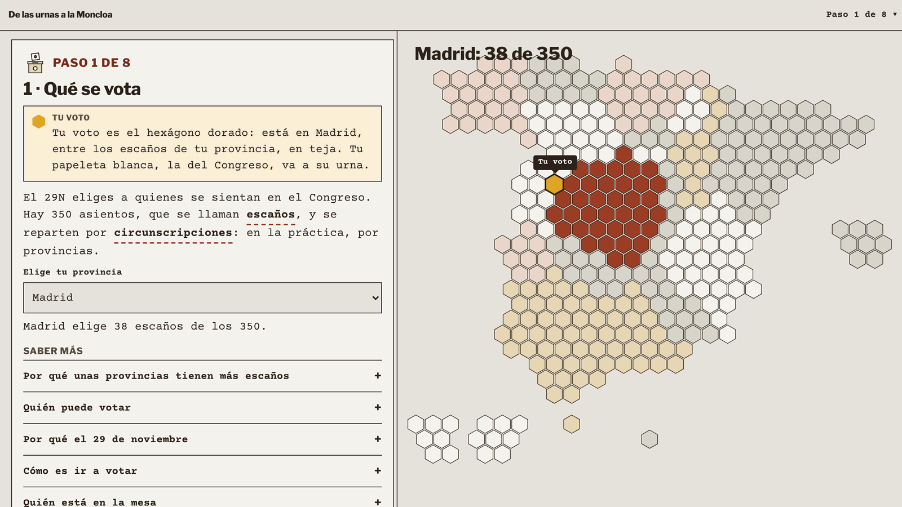
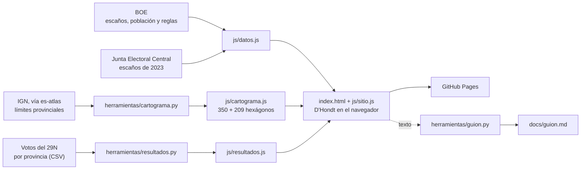

# De las urnas a la Moncloa

**Qué se vota el 29N y cómo se pasa de una papeleta a un Gobierno, contado con los 350 escaños del Congreso.**

### → [gastiaso.github.io/de-las-urnas-a-la-moncloa](https://gastiaso.github.io/de-las-urnas-a-la-moncloa/)

[](https://gastiaso.github.io/de-las-urnas-a-la-moncloa/)

El 29 de noviembre de 2026 se eligen el Congreso y el Senado. Entre la papeleta y el Gobierno hay más pasos de los que parece: cómo se reparten los escaños entre provincias, qué hace la regla D'Hondt con los votos, por qué no cuesta lo mismo un escaño en Soria que en Madrid, para qué sirve el Senado, qué mayorías hacen falta y cuánto puede tardar la investidura.

*De las urnas a la Moncloa* lo cuenta en ocho pasos. Junto al texto, los 350 escaños del Congreso, un hexágono cada uno, cambian de forma en cada paso: mapa, reparto, Senado, hemiciclo y pactos. Eliges tu provincia y sigues tu voto, el hexágono dorado, de la urna a la Moncloa.

No es una encuesta ni una predicción. Son las reglas, cada una con su artículo del BOE.

## Qué vas a encontrar

1. **Qué se vota.** Los 350 escaños y cómo se reparten entre las provincias.
2. **Del voto al escaño.** La regla D'Hondt con partidos inventados: adivina el reparto antes de verlo.
3. **Dónde votas.** Por qué los mismos porcentajes dan más partidos en Madrid que en Soria, y cuántos habitantes hay detrás de cada escaño.
4. **El Senado.** Cómo se vota, qué puede hacer y qué no.
5. **Las mayorías.** Los 176 de la primera votación, la mayoría simple de la segunda y las mayorías reforzadas.
6. **Pactos.** Una calculadora de investidura con los escaños que salieron de las elecciones de 2023.
7. **Del 29N al Gobierno.** El calendario, de la convocatoria a la investidura, fecha a fecha.

Y un cierre. Desde el 30 de noviembre se abren cinco pasos más con los resultados: qué ha pasado, tu provincia (y qué habría cambiado con otros votos), votos frente a escaños, quién puede gobernar y lo que viene.

Cada paso tiene cajones «saber más» con la fuente al pie, y las palabras subrayadas llevan su definición. También se puede leer solo el texto, sin el mapa.

## Cómo leerlo

- **Un hexágono, un escaño.** El mapa no respeta la superficie: cada provincia ocupa tantos hexágonos como diputados elige, dentro de la silueta de España. Por eso Madrid es enorme y Soria, diminuta. Canarias va en un recuadro.
- **Tu voto es el hexágono dorado.** Está en tu provincia, en el reparto, en el Senado y en el hemiciclo. En los pactos queda aparte, porque el bloque en el que estaría depende de a quién votes.
- **Los partidos del ejemplo son inventados.** El reparto D'Hondt se explica con cinco partidos, de la A a la E, para que se vea la regla sin pensar en quién gana.
- **La calculadora de pactos no usa encuestas.** Lleva los escaños que cada partido sacó en las elecciones del 23 de julio de 2023, para probar combinaciones de síes, noes y abstenciones. Los del 29N llegan el 30N, en el paso 12.
- **Lo que no tiene fuente no entra.** Las reglas están cotejadas con el texto vigente en el BOE, y las cuentas propias (cuotas, habitantes por escaño, mínimos para bloquear) se señalan como tales.

> **Si encuentras un error, avisa.** El texto se revisa y se corrige en cuanto se detecta uno.

## De dónde salen los datos

| Qué | Fuente |
|---|---|
| Escaños por provincia | Real Decreto 806/2026, de disolución y convocatoria, anexo ([BOE-A-2026-20742](https://www.boe.es/buscar/doc.php?id=BOE-A-2026-20742)) |
| Población por provincia (habitantes por escaño) | Real Decreto 1117/2025, cifras oficiales del padrón a 1 de enero de 2025 ([BOE-A-2025-25362](https://www.boe.es/buscar/doc.php?id=BOE-A-2025-25362)) |
| Reglas | Constitución, LOREG, Reglamento del Congreso, Real Decreto 605/1999 y Ley 50/1997. El artículo de cada cajón está en [`docs/guion.md`](docs/guion.md) |
| Escaños de la calculadora de pactos | Junta Electoral Central, resultados de las elecciones del 23 de julio de 2023 ([BOE-A-2023-18907](https://www.boe.es/diario_boe/txt.php?id=BOE-A-2023-18907)) |
| Resultados de prueba de la fase 2 | Escrutinio del 23 de julio de 2023, Ministerio del Interior, tal como están reunidos en Porra Electoral |
| Resultados del 29N | Ministerio del Interior: recuento provisional y, después, escrutinio general |
| Silueta y provincias del mapa | Instituto Geográfico Nacional, líneas límite (CC BY 4.0), en la versión TopoJSON de [es-atlas](https://github.com/martgnz/es-atlas) |

## Calendario

- **23 de noviembre:** lanzamiento de la fase 1.
- **24 a 28 de noviembre:** la ley prohíbe publicar encuestas esos cinco días (LOREG, art. 69.7). El sitio no lleva ninguna.
- **Noche del 29 de noviembre:** se cargan los votos del recuento provisional y se abren los pasos 9 a 13.
- **4 de diciembre:** escrutinio general. Se actualizan los resultados.
- **Después:** el calendario de la investidura se completa a medida que haya fechas.

## Cómo funciona



Es un sitio estático en JavaScript y SVG, sin compilación ni dependencias: lo que hay en el repositorio es lo que se publica. Los escaños de la fase 2 no se copian de ningún sitio: el navegador aplica la regla D'Hondt a los votos de cada provincia. Con los votos del 23J, el cálculo reproduce los 350 escaños de 2023.

Sin cookies, sin registro y sin analítica. Las tipografías se sirven desde el propio sitio, así que no se pide nada a servidores de terceros (GitHub Pages, que lo aloja, puede registrar qué ficheros se descargan).

### Verlo en local

Los módulos de JavaScript no cargan abriendo el archivo directamente; hay que servir la carpeta:

```bash
python3 -m http.server 8000
```

y abrir <http://localhost:8000>. Con `#fase2` al final de la dirección se ven los pasos de resultados con los datos de prueba del 23J, con un aviso.

### El mapa de hexágonos

Lo genera [`herramientas/cartograma.py`](herramientas/cartograma.py) (requiere `numpy`, `scipy` y `shapely`):

1. Rellena la silueta peninsular con 325 hexágonos, los escaños peninsulares.
2. Reparte las celdas entre provincias con una asignación con capacidad: cada una recibe exactamente sus escaños y la suma de distancias al cuadrado hasta su centro es mínima. Si alguna queda partida, se recompone.
3. Coloca Baleares, Ceuta y Melilla en el mar, cerca de su posición real, y Canarias en un recuadro.

Hace lo mismo con los 209 senadores elegidos en las urnas, para el paso del Senado.

```bash
python3 herramientas/cartograma.py > js/cartograma.js
```

Con un nombre de archivo `.png` como argumento, dibuja además una vista previa.

### Abrir la fase 2

```bash
# 1. Dejar los votos por circunscripción en datos/resultados_29N.csv, con el formato de datos/prueba_23J.csv
# 2. Generar el archivo de resultados y abrir la fase para todo el mundo
python3 herramientas/resultados.py datos/resultados_29N.csv --abierta \
    --etiqueta "escrutinio provisional del 29 de noviembre de 2026" --fuente "Ministerio del Interior" > js/resultados.js
# 3. Con el escrutinio general (4 de diciembre), lo mismo y además --general: la web deja de decir que es provisional
```

Antes de escribir nada, `resultados.py` comprueba que estén las 52 circunscripciones con los nombres de `js/datos.js`, que sus escaños coincidan con el decreto y que cuadren los votos. Si el CSV trae `censo`, `votantes` y `nulos`, el paso 9 da la participación.

En Windows, `herramientas/escribir_resultados.py` (mismos argumentos) hace lo mismo sin la redirección `>`, que en PowerShell puede estropear los acentos.

Otras herramientas para la noche electoral:

- `herramientas/interior_a_csv.py` pasa al CSV de `resultados.py` los ficheros de resultados del Ministerio del Interior (formato de infoelectoral) o un CSV largo hecho a mano (`datos/plantilla_largo.csv`). Las siglas se traducen a los partidos de la web con `datos/siglas.csv`.
- `herramientas/capturar_web.py` lee los resultados de la web oficial de resultados, provincia a provincia, si sirve JSON como la del 23J, y escribe los mismos CSV. Sin credenciales y con una pausa entre peticiones. `herramientas/simular_web.py` monta una copia de esa web con los ficheros oficiales del 23J, para ensayar.
- `herramientas/cotejar_escanos.py` recalcula el reparto y lo compara, provincia a provincia, con los escaños oficiales (`datos/plantilla_oficiales.csv`). Con los ficheros oficiales del 23J da los 350 escaños sin ninguna diferencia (`datos/escanos_oficiales_23J.csv`).

Las calculadoras de pactos se pueden compartir: la combinación va en la dirección (`?p6=PSOE:s,PNV:a` para el paso 6, `?p12=` para el 12).

### Estructura

| Ruta | Qué es |
|---|---|
| `index.html` | Todo el texto del sitio, paso por paso |
| `css/estilo.css` | Estilos: recorrido, escenario, portada, juegos y modo «solo texto» |
| `js/sitio.js` | El recorrido: escenario de los 350 hexágonos, tu voto, portada de sobres, menú y navegación |
| `js/contenido.js` | Juegos y calculadoras de cada paso (glosario, provincia, apuesta, Senado, pactos, resultados) |
| `js/datos.js` | Escaños y población por provincia, partidos del ejemplo, escaños de la calculadora, colores de los partidos y glosario |
| `js/textos.js` | Los textos que escribe el JavaScript (rótulos, frases de «Tu voto», calculadoras, resultados), en castellano |
| `js/dhondt.js` | Reparto D'Hondt con la barrera del 3 % y cálculo del último escaño |
| `js/mapa.js` y `js/hemiciclo.js` | Geometría del mapa de hexágonos y de los 350 asientos del hemiciclo |
| `js/fichas.js` | Iconos de cada paso |
| `js/cartograma.js` y `js/resultados.js` | Posición de los hexágonos y resultados de la fase 2 (generados) |
| `js/moncloa.js` | «LA MONCLOA» escrito con los 350 escaños, para el último paso (generado con `node herramientas/moncloa.mjs`) |
| `js/referencia_2023.js` y `js/equivalencias.js` | Escaños del 23J por provincia (generados con `herramientas/referencia_2023.py`) y con qué partido de 2023 se compara cada uno en el paso 9 |
| `herramientas/` | Generadores del mapa, de los resultados y del guion; conversor y cotejo de resultados |
| `fuentes/` | Courier Prime y Libre Franklin en woff2, con su licencia |
| `img/` | Imagen para compartir (1200 × 630; se regenera con `node herramientas/compartir.mjs`), favicon e icono |
| `datos/prueba_23J.csv` | Votos del 23J por circunscripción, para probar la fase 2 |
| `datos/escanos_oficiales_23J.csv` | Escaños oficiales del 23J por circunscripción, para probar el cotejo |
| `datos/siglas.csv` y `datos/siglas_23J.csv` | De las siglas del Ministerio a los partidos de la web (la segunda, solo para el 23J) |
| `datos/plantilla_largo.csv` y `datos/plantilla_oficiales.csv` | Plantillas para copiar resultados y escaños a mano |
| `docs/guion.md` | Todo el texto del sitio con la fuente de cada cajón (generado) |
| `idiomas/` y `js/idiomas/` | Las traducciones: las frases de la página (`xx.txt`) y los textos del JavaScript (`xx.js`) de cada idioma |
| `ca/`, `va/`, `gl/`, `eu/` y `en/` | La página en catalán, valenciano, gallego, euskera e inglés (generadas) |

Tras cambiar un texto en `index.html`, hay que regenerar el guion (`python3 herramientas/guion.py > docs/guion.md`) y las páginas de los demás idiomas.

### Idiomas

El sitio se escribe en castellano (`index.html` y `js/textos.js`). Las versiones en catalán, valenciano, gallego, euskera e inglés se generan a partir de él:

```bash
python3 herramientas/idiomas.py            # genera ca/, va/, gl/, eu/ y en/ y dice qué frases faltan por traducir
python3 herramientas/idiomas.py --comprueba  # no escribe nada: avisa si alguna página está sin regenerar
node herramientas/prueba_idiomas.mjs       # comprueba que a los textos del JavaScript de cada idioma no les falta nada
```

- `idiomas/xx.txt` lleva cada frase de la página en castellano y, debajo, su traducción. Si una frase de `index.html` cambia o es nueva, el generador la apunta al final de cada archivo para traducirla y, mientras tanto, la página de ese idioma la muestra en castellano.
- `js/idiomas/xx.js` lleva los textos del JavaScript, con las mismas entradas que `js/textos.js`, y los nombres de las provincias en ese idioma.
- La edición inglesa no es una traducción literal: está adaptada para quien lee desde fuera de España. Explica lo que aquí se da por sabido, no habla de «tu voto» sino de un voto que se sigue, y añade dos cajones propios («Spain in brief» y «Who the parties are»).
- La etiqueta y la fuente que se pasan a `herramientas/resultados.py` llegan a la página en castellano: para que salgan traducidas hay que añadirlas a la lista `dato` de cada `js/idiomas/xx.js`. Ya están las de la noche del 29N y las del 4 de diciembre (`escrutinio provisional del 29 de noviembre de 2026, con el 99,9 % escrutado`, con cualquier porcentaje; `escrutinio general del 4 de diciembre de 2026`; `Ministerio del Interior, escrutinio provisional` y `…, escrutinio general`).
- La imagen para compartir (`img/compartir.jpg`) es la misma en todos los idiomas y lleva el título en castellano.
- Para quitar o añadir un idioma hay que tocar tres sitios: la lista `LENGUAS` de `herramientas/idiomas.py`, la lista `<nav class="idiomas">` de `index.html` y sus enlaces `hreflang` de la cabecera.

## Limitaciones

- **El mapa deforma a propósito.** Cuenta escaños, no territorio. La posición de cada provincia es aproximada, y alguna queda estirada.
- **Habitantes no son votantes.** Los habitantes por escaño salen de la población oficial, que incluye a menores y a extranjeros que no votan en estas elecciones.
- **La calculadora de pactos mira atrás.** Hasta el 30N lleva los escaños de 2023, no una previsión del 29N.
- **La noche electoral no da el resultado oficial.** Los primeros resultados son del recuento provisional; el oficial, con el voto desde el extranjero, llega el 4 de diciembre.
- **El Senado, solo en las reglas.** Los pasos de resultados dan los del Congreso; los del Senado, todavía no.
- **Es una introducción.** Los cajones dan la norma exacta, pero no cubren todos los casos que prevé la ley.

## Cómo citar

> Astiaso Llamazares, G. (2026). *De las urnas a la Moncloa: qué se vota el 29N y cómo se llega a un Gobierno* [sitio web y software]. https://gastiaso.github.io/de-las-urnas-a-la-moncloa/. CC BY 4.0.

GitHub ofrece la cita en otros formatos (APA, BibTeX) desde el botón *Cite this repository*.

## Licencias

- **Código:** [MIT](LICENSE). Se puede reutilizar con cualquier fin conservando el aviso de autoría.
- **Textos del sitio y del guion, iconos, imágenes y posición de los hexágonos:** [CC BY 4.0](https://creativecommons.org/licenses/by/4.0/deed.es). Se pueden reutilizar con cualquier fin citando la autoría.
- **Normas publicadas en el BOE:** no son objeto de propiedad intelectual (Ley de Propiedad Intelectual, art. 13).
- **Límites provinciales:** © Instituto Geográfico Nacional, CC BY 4.0.
- **Tipografías:** Courier Prime y Libre Franklin, con licencia SIL Open Font License 1.1, servidas desde el propio sitio.

Detalle y fórmula de cita en [`LICENCIA-DATOS.md`](LICENCIA-DATOS.md).

## Contacto

Errores, dudas o sugerencias: por [LinkedIn](https://www.linkedin.com/in/guillermo-astiaso) o abriendo una [incidencia](https://github.com/gastiaso/de-las-urnas-a-la-moncloa/issues).

## Proyectos relacionados

- [Porra Electoral](https://gastiaso.github.io/porra-electoral/) ([repositorio](https://github.com/gastiaso/porra-electoral)): la media de las encuestas de las generales del 29N y los escaños que salen de ella. De ahí salen los datos de prueba del 23J.
- [Historias con los barómetros del CIS](https://gastiaso.github.io/historias/) ([repositorio](https://github.com/gastiaso/historias)): historias para leer con scroll, en las que el gráfico cambia mientras avanza el texto.
